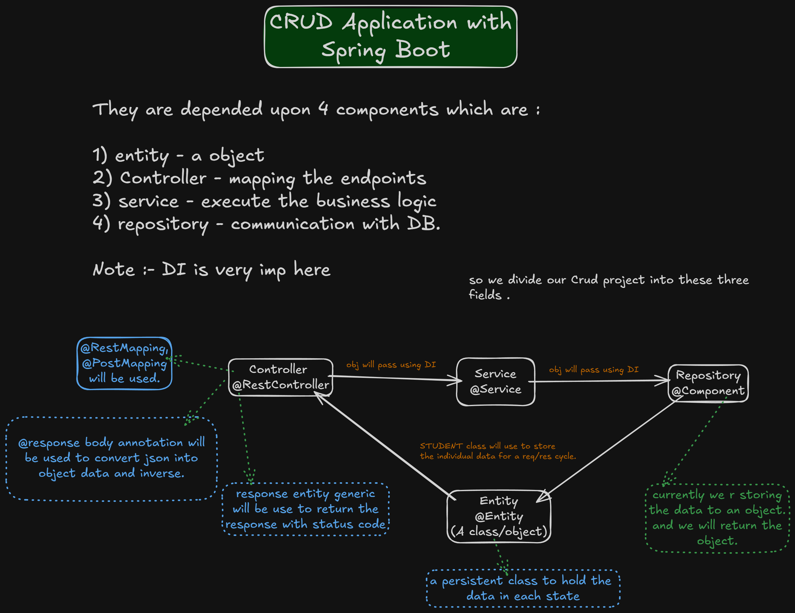

<h1>Notes of CRUD using Spring-Boot</h1>

So, firstly for using/creating CRUD using Spring-boot is directly depended upon these 4 things:-

----> 1) Entity - The class/object will be used to store the mapped json data.

----> 2) Controller - Here Endpoints mapping will take place. Means this handles the Request and response.
                        the first class to interact with.

                        --> @RestController will be the annotation with more annotations like...
                            @Requestmapping will be used to map the end points.
                            @PostMapping - for Post method.
                            @RequestBody - used for converting json to object data and inverse too.
                            
            Note :- ResponseEntity will be used to send the response data into more wider way. like sending the status code too.

----> 3) Service - here business logic will be there.
                    @Service will be used .

-----> 4) Repository - this layer interacts with Database ... store/retrieve the data.
            right now object is used to store the data... & we returned the object.

Note :- Dependency injection is very imp for managing and flow of controller - service - and repository.

        
                            